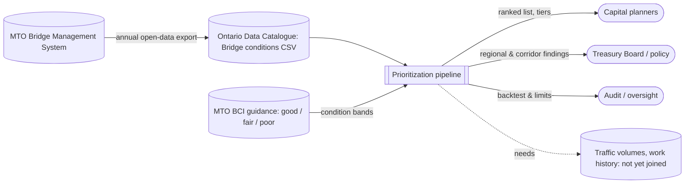
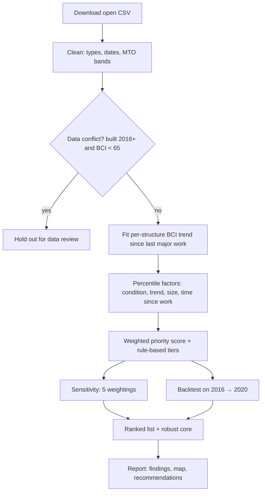

# Business Analysis: Ontario Bridge Repair Prioritization

**Author:** Feras Elghandour · **Type:** Decision-support analysis on public open data

> **Scope note:** this is an independent analysis of the 2020 public file. It is not an MTO product. The BCI is a repair measure, not a safety rating.

## 1. Business problem

Ontario's Ministry of Transportation maintains about 5,000 provincial bridges and culverts on a finite capital budget. The open inspection data is published as one wide file, so it does not directly answer the questions that drive funding:
- Which structures should be repaired first?
- Where is the backlog concentrating?
- How much work is coming next?

## 2. Objectives and success measures

| Objective | Measure |
|---|---|
| Rank repair need transparently | A reproducible score whose top results stay stable under alternative weightings |
| Expose where the backlog concentrates | Poor and fair shares by region, structure type, age and corridor |
| Anticipate future workload | Projected structures crossing BCI 60, by year |
| Show how reliable the method is | Backtest against observed 2016→2020 outcomes |

## 3. Stakeholders

| Stakeholder | Interest |
|---|---|
| MTO Structures Office and regional offices | Capital planning, inspection scheduling |
| Treasury Board / capital planning | Allocating funds across regions and asset types |
| Northern municipalities and freight users | Corridor reliability on Highways 11 and 17 |
| Office of the Auditor General | Evidence that fair and poor structures enter capital plans |
| Public and media | Transparency on infrastructure condition |

## 4. Context diagram

## 5. Process map

## 6. Use cases

- **UC-01 Rank structures for a capital cycle.** A planner opens the ranked list, filters by region and tier, and exports candidates.
- **UC-02 Compare regions.** A policy analyst compares poor and fair shares to test whether funding matches need.
- **UC-03 Size next years' workload.** A planner reads projected crossings per year to set a budget envelope.
- **UC-04 Check data quality.** A data steward reviews held-out conflicts, missing counties and old inspection dates.

## 7. Business rules

| ID | Rule |
|---|---|
| BR-01 | Bands follow MTO guidance: good 70–100, fair 60–70, poor < 60 |
| BR-02 | A rise of more than 5 BCI points between inspections is treated as a repair; the trend restarts after it |
| BR-03 | A trend needs at least 3 inspections spanning at least 4 years; otherwise the median trend is used |
| BR-04 | Tier 1 = poor now; Tier 2 = projected below 60 by 2023; Tier 3 = fair and declining by more than 0.5 points a year |
| BR-05 | Records with a build year of 2016 or later and a BCI under 65 are held out as data conflicts |

## 8. Requirements

| ID | Requirement | Status |
|---|---|---|
| FR-01 | Rank every rated structure with a documented, reproducible score | Met (`out/priority_list.csv`) |
| FR-02 | Show condition by region, type, age and corridor | Met (report) |
| FR-03 | Project crossings below BCI 60 per year | Met |
| FR-04 | Test ranking stability and model accuracy | Met (sensitivity and backtest) |
| FR-05 | Weight by traffic consequence | Not met: needs traffic-volume data |
| NFR-01 | One command reproduces all outputs from the raw file | Met (`run_all.sh`) |
| NFR-02 | Every limitation is stated next to the results | Met |

## 9. Acceptance criteria

| Req | Given / When / Then | Evidence |
|---|---|---|
| BR-01 | Given BCI 59.99, 60 and 70, when banded, then they are poor, fair and good | `tests/test_prepare.py` |
| BR-02 | Given a 65 → 85 jump, when the trend is fitted, then only points after the jump are used | `tests/test_prepare.py` |
| BR-03 | Given two inspections, when the trend is fitted, then no trend is returned | `tests/test_prepare.py` |
| NFR-01 | Given the raw CSV, when `run_all.sh` runs twice, then `findings.json` is identical | Verified |

## 10. Next steps

1. Join the provincial traffic-volume (AADT) data so the ranking reflects consequence, not just size.
2. Request the current Bridge Management System extract and completed-work records, then rerun.
3. Validate the top tier with regional structures engineers.
